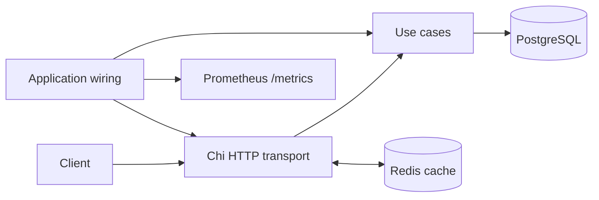

# Room Booking Service

[](https://github.com/SIniutin/room-booking-service/actions/workflows/ci.yml)
[](https://go.dev/)
[](LICENSE)

A production-style Go backend for booking meeting rooms. It combines a layered
architecture with PostgreSQL-enforced booking consistency, Redis caching, JWT
authentication, Prometheus metrics, graceful shutdown, and unit, integration,
end-to-end, race, and load tests.

## Why this project is interesting

- Concurrent requests cannot create two active bookings for one slot: a partial
  unique index in PostgreSQL is the final consistency boundary.
- Hot room and slot reads are cached in Redis with explicit invalidation.
- Repository and E2E tests run against real PostgreSQL and Redis containers.
- Slots are pre-generated for a rolling seven-day window to keep reads cheap and
  preserve stable slot identifiers.
- CI checks formatting, `go vet`, `golangci-lint`, the race detector, integration
  tests, E2E tests, and a production build.

## Architecture



The dependency direction is `transport -> usecase -> domain/repository
interfaces`; PostgreSQL implementations and application wiring stay at the
edges. See [architecture decisions](docs/architecture.md) for the reasoning.

## 30-second quick start

Requirements: Docker with Compose and `curl`.

```bash
docker compose up --build -d
curl http://localhost:8080/_info
curl -s -X POST http://localhost:8080/dummyLogin \
  -H 'Content-Type: application/json' \
  -d '{"role":"user"}'
```

The Compose `keys` service generates a fresh RSA development key pair in a
named volume. No private key is stored in Git. The API is available at
`http://localhost:8080`; Prometheus metrics are exposed at `/metrics`.

Useful commands:

```bash
make up             # build and start the stack
make logs           # follow API logs
make seed           # create development admin and user tokens
make unit           # unit tests with the race detector
make integration    # PostgreSQL repository tests
make e2e            # full API scenarios via Testcontainers
make rotate-keys    # replace Docker development JWT keys
make down
```

## Booking consistency

The database migration defines the invariant directly:

```sql
CREATE UNIQUE INDEX idx_bookings_slot_active
    ON bookings (slot_id)
    WHERE status = 'active';
```

Two simultaneous inserts are exercised by
`TestBookingRepo_ConcurrentCreateAllowsOnlyOneActiveBooking`: exactly one
succeeds, the other maps PostgreSQL error `23505` to `ErrSlotAlreadyBooked`, and
the final database count remains one. An application-level “check then insert”
alone would leave a race window.

## Stack

- Go, Chi, pgx, goose
- PostgreSQL 17 and Redis 7
- RS256 JWT authentication and role-based middleware
- Prometheus metrics
- Testcontainers, Docker Compose, k6
- React and Vite demo frontend

## Configuration

| Variable | Default in Compose | Purpose |
| --- | --- | --- |
| `HTTP_PORT` | `8080` | API listen port |
| `HTTP_ALLOWED_ORIGINS` | local frontend origins | CORS allowlist |
| `POSTGRES_DSN` | Compose PostgreSQL | Database connection |
| `REDIS_ADDR` | `redis:6379` | Redis connection |
| `JWT_PRIVATE_KEY_PATH` | `/app/secrets/private.pem` | RSA signing key |
| `JWT_PUBLIC_KEY_PATH` | `/app/secrets/public.pem` | RSA verification key |
| `JWT_TTL` | `24h` | Access-token lifetime |

For a non-Docker local process, run `make keys`; generated PEM files are ignored.
`POST /dummyLogin` is a development/demo endpoint and must not be exposed in a
production deployment.

## Tests and quality checks

```bash
make unit
make integration  # Docker required
make e2e          # Docker required
make vet
make lint
```

GitHub Actions runs the same layers independently so a failure identifies the
affected boundary. The integration suite verifies SQL and error mapping against
real PostgreSQL; E2E covers authentication, room setup, booking, duplicate
booking rejection, cancellation, cache behavior, and metrics.

## Load-test result

The checked-in k6 scenario targets
`GET /rooms/{roomId}/slots/list?date=...`. Under the recorded local profile of
20 virtual users (30 s ramp-up, 1 min plateau, 20 s ramp-down), it produced
3,452 requests at about 31.16 requests/s with `p99 = 3.88 ms` and 0% request
failures. This is a result for that exact environment and profile, not a general
throughput claim. See the [full load-test report](docs/load-testing.md).

## Documentation

- [Architecture and design decisions](docs/architecture.md)
- [Load-test scenario and recorded results](docs/load-testing.md)
- [OpenAPI specification](api.yaml)
- [Development-key policy](secrets/README.md)

## Known trade-offs

- Cache coverage is intentionally narrow and invalidation is explicit.
- Repository and E2E tests are slower because they start real dependencies.
- The frontend is a local demonstration client rather than a deployed product.
- `dummyLogin` exists only to make the portfolio scenario easy to reproduce.

## License

[MIT](LICENSE)
